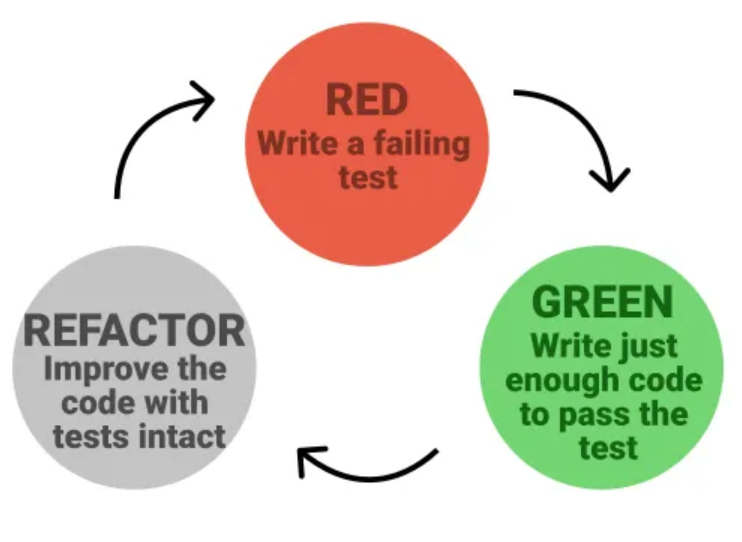

# HW 6 - Test Driven Development

The objective for this homework assignment is to practice Test-Driven-Development (TDD). In TDD tests are developed first, followed by the code implementation with the objective to simply pass the tests, then refactoring to esnure the implemented code is written in the most efficient manner.

TDD has a life cycle of Fail -> Pass -> Refactor, so it's to be expected that refactoring your code may cause to tests to fail again. If this happens, simply restart the Fail -> Pass -> Refactor cycle as many times as needed.

### Your Objective

All Unit and Integration Tests have been written for you in the `test/` directory. Your objective is to write code inside the `lib/` directory to pass all tests.

**Important!**

Each group of tests has a `skip: true` parameter at the end. This means at the start of your homework, all tests will skip. SKIPPED TESTS ARE NOT PASSING TESTS! Make sure to remove the `skip: true` or pass a false value, ex: `skip: false`.

## Increment Page

### Unit Tests

**Step 1 - Fail:** Look for the Unit Test group inside `test/unit_tests.dart` and remove the `skip: true` at the end.

**Step 2 - Pass:** Add code inside `lib/utils/increment.dart` to pass the Unit Tests.

**Step 3 - Refactor:** Go back and refactor code if needed.

### Integration Tests

**Step 1 - Fail:** Look for the Integration Test group inside `test/integration_tests.dart` and remove the `skip: true` at the end.

**Step 2 - Pass:** Add code inside `lib/screens/increment_page.dart` to pass the Integration Tests.

**Step 3 - Refactor:** Go back and refactor code if needed.

**Objective:**

## Convert Page

### Unit Tests

**Step 1 - Fail:** Look for the Unit Test group inside `test/unit_tests.dart` and remove the `skip: true` at the end.

**Step 2 - Pass:** Add code inside `lib/utils/convert.dart` to pass the Unit Tests.

**Step 3 - Refactor:** Go back and refactor code if needed.

### Integration Tests

**Step 1 - Fail:** Look for the Integration Test group inside `test/integration_tests.dart` and remove the `skip: true` at the end.

**Step 2 - Pass:** Add code inside `lib/screens/convert_page.dart` to pass the Integration Tests.

**Step 3 - Refactor:** Go back and refactor code if needed.

**Objective:**

## Paper Rock Scissors Page

### Unit Tests

**Step 1 - Fail:** Look for the Unit Test group inside `test/unit_tests.dart` and remove the `skip: true` at the end.

**Step 2 - Pass:** Add code inside `lib/utils/paper_rock_scissors.dart` to pass the Unit Tests.

**Step 3 - Refactor:** Go back and refactor code if needed.

### Integration Tests

**Step 1 - Fail:** Look for the Integration Test group inside `test/integration_tests.dart` and remove the `skip: true` at the end.

**Step 2 - Pass:** Add code inside `lib/screens/paper_rock_scissors_page.dart` to pass the Integration Tests.

**Step 3 - Refactor:** Go back and refactor code if needed.

**Objective:**

 

## Grading Criteria

| Task | Value of each task | Possible Points Lost |
|---|---|---|
| Unit Tests - Increment Class | 10 pts | All tests are passing. |
| Integration Tests - Increment Page | 10 pts | All tests are passing. |
| Unit Tests - Convert Class | 20 pts | All tests are passing. |
| Integration Tets - Convert Page | 15 pts | All tests are passing. |
| Unit Tests - PaperRockScissors Class | 25 pts | All tests are passing. |
| Integration Tets - PaperRockScissors Page | 20 pts | All tests are passing. |
| | 100 points total | |

